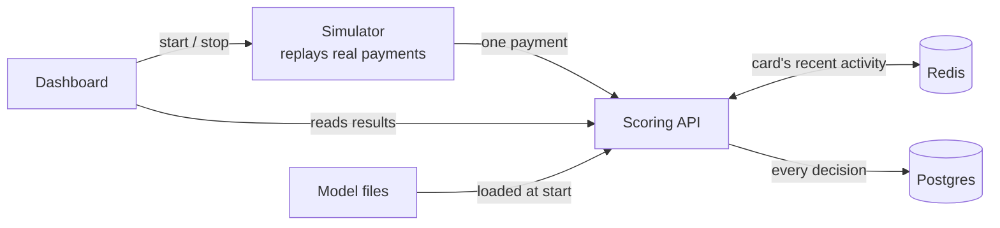

# Gatekeeper

**A fraud detection system that looks at every card payment and decides, in about a millisecond,
whether to let it through or flag it as suspicious, and explains why.**

I built this in October 2026, as the capstone project for HarvardX's
*Machine Learning and AI with Python*.

---

## Why I built this

Every time you pay online, someone has to decide very quickly whether it's really you. Get it
wrong one way and a fraudster walks away with someone's money. Get it wrong the other way and a
real customer gets their card declined at checkout, which is embarrassing for them and costly for
the business.

I wanted to build the whole thing myself, not just train a model in a notebook. So Gatekeeper goes
from raw data all the way to a working service: it learns from past payments, picks the best model
in a fair contest, answers live requests in milliseconds, remembers what each card has been doing,
keeps a record of every decision, and shows it all on a dashboard.

## What it does, in plain words

1. **It learned from the past.** I trained it on about 415,000 real online payments, each one
   labelled as fraud or genuine.
2. **It judges new payments.** Each new payment gets a fraud score between 0 and 1. If the score is
   high enough, the payment is flagged as **suspicious**; otherwise it's **allowed**.
3. **It explains itself.** For every flagged payment it lists the three things that made it look
   risky, for example "the amount is unusually high" or "the email domain is risky".
4. **It's tested honestly.** All the results below come from a month of payments the model had
   never seen.

## The results

Tested on 85,430 payments from a month the model never trained on:

| What I measured | Result |
|---|---|
| Fraud caught | about **49%** of fraudulent payments |
| Genuine customers wrongly flagged | about **1.3%** (roughly 1 in 75) |
| Fraud losses prevented | about **40%** ($182,961) |
| When it flags a payment, how often it's really fraud | **57%** |
| Time to decide | about **0.3 ms** on average |
| Payments it can handle | about **1,350 per second** on a laptop |

I also checked that the live system gives the same answers as my notebooks. It caught 48.1% of fraud
with 1.11% false alarms when 20,000 payments were streamed through it, which matches the notebook
results. So what runs live is exactly what I tested.

## How it works



When a payment arrives, the **scoring API** does seven things:

1. **Prepares it.** Turns the payment into the 431 numbers the model expects, using exactly the
   same rules as in training.
2. **Scores it.** The model gives a fraud score from 0 to 1.
3. **Checks a safety rule.** Amounts of zero or less, or above $50,000, are flagged straight away
   (more on why below).
4. **Looks at the card's history.** How many payments the card made in the last hour, what it
   usually spends, and whether this device is new for it.
5. **Decides.** Suspicious if the score is 0.1623 or higher, or if the safety rule fired.
6. **Explains.** For flagged payments, works out the top 3 reasons.
7. **Answers and saves.** Replies straight away; the decision is saved to the database in the
   background so saving never slows the answer.

### The pieces

| Piece | What it does | Built with |
|---|---|---|
| Notebooks | Explore the data, run the model contest, choose the winner | Python, scikit-learn, LightGBM on Kaggle |
| Scoring API | Receives a payment, returns a decision | FastAPI |
| Card memory | Keeps each card's recent activity | Redis |
| Decision log | Saves every decision and its reasons | Postgres |
| Simulator | Plays the unseen month back as a live stream of payments | Python |
| Dashboard | Shows live results and lets you test your own payment | Streamlit |
| Packaging | Runs everything together with one command | Docker Compose |

## The data

I used the [IEEE-CIS Fraud Detection](https://www.kaggle.com/c/ieee-fraud-detection) dataset from
Kaggle: 590,540 real online payments from the payment company Vesta. Only **3.5%** of them are fraud.

Most of the 434 columns are anonymised for privacy, so for many of them we only know the general
group (counts, time gaps, match checks, device details), not their exact meaning.

**I split the data by time, not at random.** The model learns from the first 120 days, I compare
models on the next 32 days, and the final test uses the last 30 days. That's how it works in real
life: you train on the past and use the model on the future. A random split lets the model peek at
the future, and the results look better than they really are. I saw this happen. One model scored
0.675 on a check that mixed in training-period data, but only 0.504 on the later month.

| Part | Days | Payments | Used for |
|---|---|---|---|
| Training | 1–120 | 414,542 | Teaching the models |
| Validation | 121–152 | 90,568 | Comparing models, choosing the threshold |
| Replay | 153–182 | 85,430 | The final test and the live stream |

The data isn't stored in this repository, because Kaggle's rules don't allow sharing it.

## The model contest

I trained five tree-based models on the same data and judged them on the same month:

| Model | How it works, simply | Score (PR-AUC) |
|---|---|---|
| Decision tree | One chain of yes/no questions | 0.368 |
| AdaBoost | Small trees, each focusing on the mistakes of the last | 0.401 |
| Bagging | 50 trees, each trained on a random sample, then they vote | 0.504 |
| Random forest | Like bagging, but each tree sees only some features | 0.504 |
| **LightGBM** (winner) | 472 trees built one after another, each fixing what's left of the errors | **0.620** |

**Why not just use accuracy?** Because only 3.5% of payments are fraud, a model that never flags
anything would be 96.5% "accurate" and completely useless. So I used measures that focus on fraud:

- **PR-AUC:** how well the scores separate fraud from genuine payments overall (random guessing
  gets 0.035, a perfect model gets 1).
- **Fraud caught when only 1% of genuine customers are flagged:** a practical number a business
  can actually use. LightGBM: 52.8%. Single tree: 31%.
- **Cost:** missed fraud amounts plus $10 for every genuine customer wrongly flagged.

LightGBM won on all of them and was also the quickest of the multi-tree models to score, so it became the champion. I chose
its threshold (0.1623) on the validation month so that 1% of genuine payments get flagged. Then I
froze everything and tested it once on the replay month. Those are the results at the top.

## Why a payment was flagged

A score of 0.83 on its own doesn't tell anyone much. So every flagged payment comes with its top 3
reasons, worked out with **SHAP**. SHAP measures how much each piece of information pushed this
particular payment's score up or down compared with an average payment. The three biggest pushes
are the reasons. For example:

```json
"reasons": [
  {"name": "Payment amount", "value": "$246.35", "effect": "raises risk"},
  {"name": "Payer's email domain", "value": "anonymous.com", "effect": "raises risk"},
  {"name": "Linked count C13", "value": "1", "effect": "raises risk"}
]
```

Working out reasons takes about 20–30 ms, while scoring takes about 0.1 ms. So by default reasons
are only worked out for flagged payments, which are the ones a fraud analyst would actually look at.

## A bug that taught me something

While testing, I typed in a payment of **$118,888,007,988,899** and the system **allowed it**.

Tree models can't handle values far outside anything they saw in training. To the model, $118
trillion looked just like the biggest normal payments it had seen, so it gave it an ordinary score.
Worse, it went into the card's history and made that card's "usual amount" $39 million.

The fix was a simple rule in front of the model: amounts of zero or less, or above $50,000, are
flagged no matter what the model says, and they're kept out of the card's history. The lesson I
took from it: a model only knows the world it was trained on, so a real system has to check its
inputs before trusting it.

## Try it yourself

You'll need [Docker](https://www.docker.com/). The trained model and the replay data come from my
Kaggle notebooks and aren't stored here, so put them in these folders first:

```
models/lightgbm_model.txt   models/preprocess.json   models/champion.json   (from notebook 05)
data/replay.parquet                                                       (from notebook 01)
```

Then:

```bash
cp .env.example .env          # open it and set your own database password
docker compose up --build -d
```

Give it about 30 seconds, then open:

| What | Where |
|---|---|
| **The dashboard** | http://localhost:8501 |
| The scoring API (interactive docs) | http://localhost:8000/docs |
| The simulator | http://localhost:8001/docs |

### Using the dashboard

Press **▶ Start** in the sidebar and watch the unseen month stream in. You'll see:

- the main numbers (fraud caught, false alarms, money saved, speed), updating every 2 seconds;
- a chart of the latest fraud scores against the threshold line;
- the latest flagged payments and **why** each was flagged;
- a table of every recent decision marked ✅ fraud caught, ❌ fraud missed, ⚠️ false alarm or
  ✓ genuine allowed;
- a **Test a payment** form, where you can type in your own payment and see the decision and its
  reasons. Try the same card twice with a much bigger amount and watch its history change.

### Sending a payment yourself

```bash
curl -s localhost:8000/score -H "Content-Type: application/json" -d '{
  "transaction_id": "demo-1",
  "features": {"TransactionAmt": 117.0, "ProductCD": "W", "card1": 9500, "P_emaildomain": "gmail.com"}
}'
```

You'll get back the decision, the fraud score, how long it took and the card's recent history.
Any field you leave out is treated as unknown, just like missing values in training.

Other useful addresses:

| Address | What you get |
|---|---|
| `GET /health` | Is the model loaded, are Redis and Postgres working |
| `GET /stats` | Totals: payments, flagged, fraud caught, false alarms, money stopped and missed |
| `GET /decisions/recent` | The latest decisions |

### More things to try

```bash
# Score 30 real unseen payments (10 of them fraud) and compare with the truth
docker compose exec api python scripts/score_samples.py --n 30 --fraud 10

# Same, showing the reasons for each flagged payment
docker compose exec api python scripts/score_samples.py --n 10 --fraud 5 --reasons

# Stress test: send 20,000 payments as fast as possible
docker compose exec simulator python -m sim.cli --rate 0 --limit 20000 --workers 8

# Run the automated tests (31 in total)
docker compose exec api sh -c "pip install -q -r requirements-dev.txt && python -m pytest -q tests"
docker compose exec simulator sh -c "pip install -q -r requirements-dev.txt && python -m pytest -q tests"
```

## What's in this repository

```
notebooks/   the Kaggle notebooks: exploring the data, the model contest, choosing the champion
api/         the scoring service
simulator/   plays the unseen month back as a live stream
dashboard/   the live dashboard
deploy/      files for putting it online (HTTPS, domain, server setup)
notes/       my daily build notes
data/        local only, not stored in GitHub
models/      local only, not stored in GitHub
```

## What it can't do (yet)

I want to be honest about the limits:

- **About half of fraud still gets through.** Many missed frauds look completely normal. One example
  was an $8.40 payment, smaller than that card usually spends, with a fraud score of 0.009. There was
  simply nothing unusual about it.
- **It does worse by value than by count.** It stops about 49% of fraud payments but only about 42%
  of fraud dollars, because the frauds that slip through tend to be bigger.
- **The card history isn't used by the model yet.** It's shown to analysts, but the model was trained
  without it. Using it would mean retraining.
- **Fraud changes over time.** The score dropped from 0.620 to 0.552 between the validation month
  and the final month. A real system would need regular retraining.
- **Many columns are anonymised**, so some explanations can only say "Risk signal V258" rather than
  what it really means.

## What I'd do next

- Feed the card history into the model and retrain it.
- Retrain regularly and watch for the model getting worse as fraud patterns change.
- Send borderline payments to a person for review instead of a hard yes or no.

## What I learned

- **Split by time.** Random splits make fraud models look better than they are.
- **Choose measures that fit the problem.** Accuracy means nothing when fraud is rare.
- **Models only know what they've seen.** Always check inputs before trusting a prediction.
- **Prove it end to end.** Getting the same numbers in the notebook, the API and the live stream is
  what made me trust the system.
- **Report the honest number.** The final test score is lower than the validation score, and that
  lower number is the real result.

## Credits

- Data: [IEEE-CIS Fraud Detection](https://www.kaggle.com/c/ieee-fraud-detection), provided by Vesta
  Corporation and the IEEE Computational Intelligence Society on Kaggle.
- Course: HarvardX, *Machine Learning and AI with Python*.